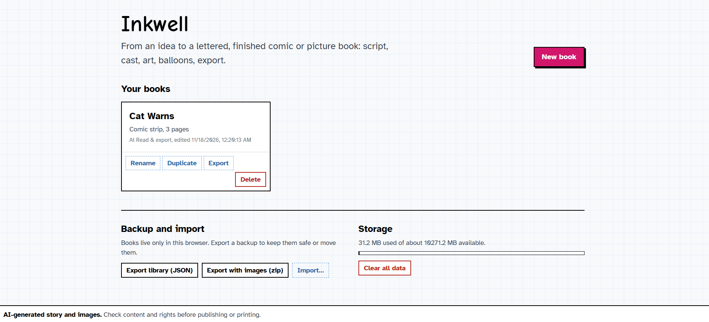

An AI comic and storybook maker that takes you from idea to lettered, exportable book, with writing and art models served through Hopscotch.

## Overview

This app turns an idea into a finished comic or picture book. You start with a premise, a pasted story or a URL. The AI writes the script page by page and panel by panel, and you watch it stream in. Then you edit the panels, design the characters and art style, render the artwork, add speech balloons and captions, and export the book.

## How Hopscotch Helped

Hopscotch is the gateway behind every writing and image call. It saved work in six areas.

**One key covers writing and art** Hopscotch gives you one API for 500+ models from many providers and works with the OpenAI SDK you already use: you change the base URL, API key, and model name. The app's writing model and image model come from the same catalog and are billed to the same balance, so the server needs only one key in `.env`.

## Results

## More Use Cases
