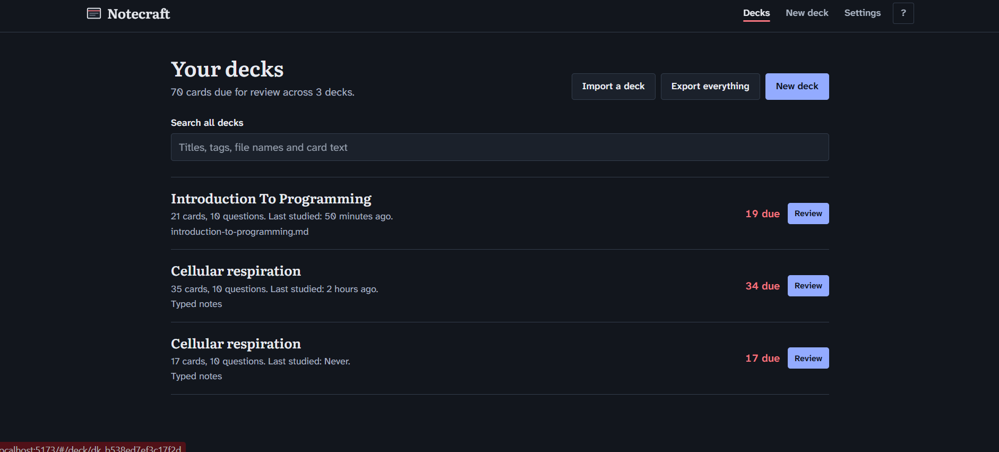
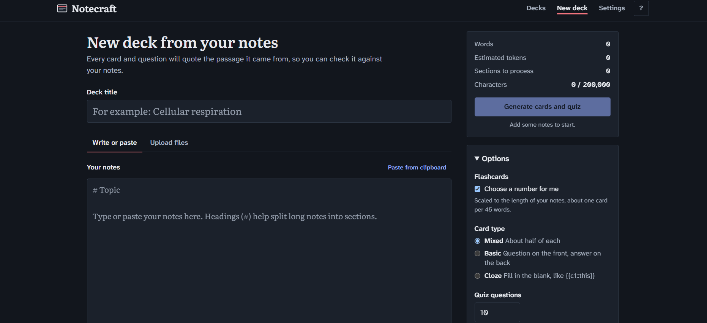

Turns your own notes into flashcards and a multiple-choice quiz. Each card and question links back to the line in your notes it came from, so you can check it in one click.

## Overview

Turns your notes into flashcards and a multiple-choice quiz. You can paste text or upload TXT, Markdown, PDF or DOCX files. Each card and question shows the quote from your notes it came from, and the app flags any item it can't match to your notes. The app schedules flashcard reviews with spaced repetition, saves every quiz attempt and exports decks.

## How Hopscotch Helped

The app talks to Hopscotch through the standard OpenAI SDK, so connecting it only took a new base URL and API key. Hopscotch supplies the model list, returns structured JSON for cards and questions, and reports the token count and cost of each request

- **No new SDK to learn.** uses the standard OpenAI SDK. Hopscotch works with any OpenAI client, so you change one base URL and one API key and keep your OpenAI SDK.
- **A model picker that stays current.** The app's model list comes straight from Hopscotch's `/v1/models` endpoint. Each entry's id is what you send as `model`, so you never maintain a hardcoded list.

## Results

## More Use Cases
