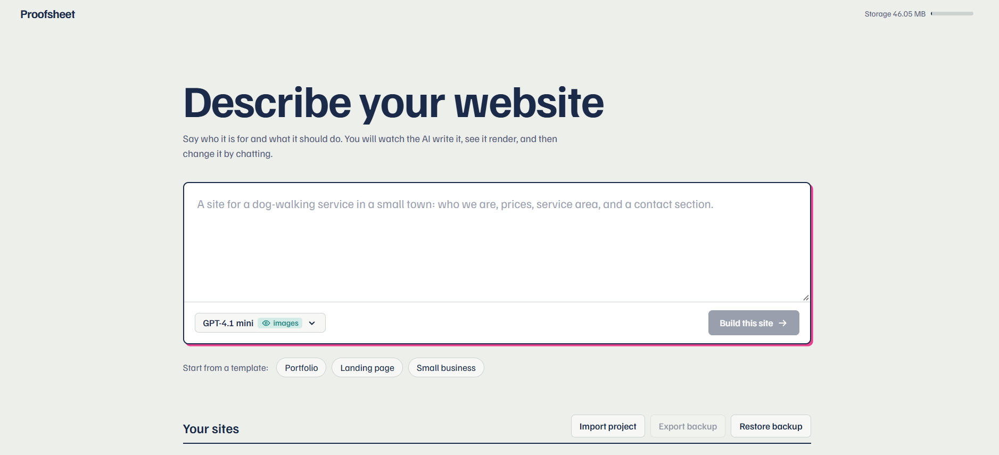
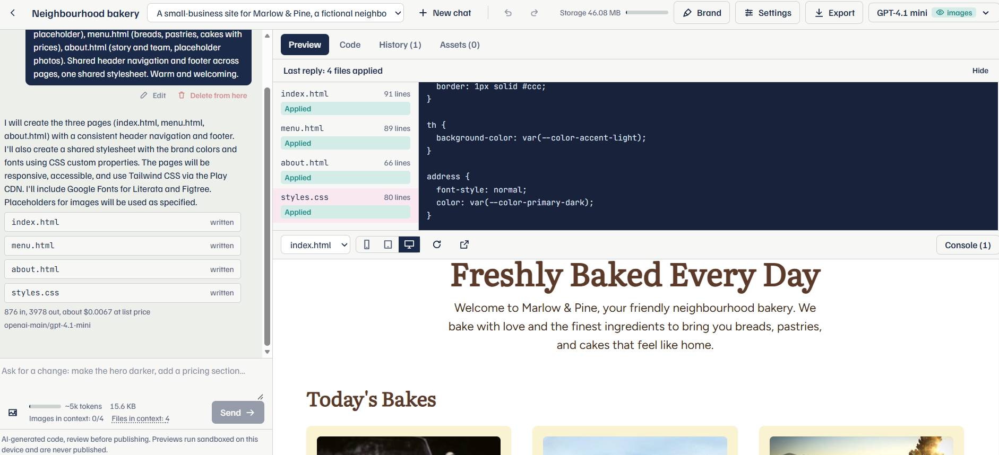

An AI website maker. Describe a site in chat, watch the AI write the code, and see it render live in a sandboxed preview. You can also send screenshots, sketches, or brand images for it to build from.

## Overview

A chat-based website maker. You describe the site you want, and the AI writes it in plain HTML, CSS and JavaScript while you watch. A "building" panel shows each file as it's written, and the finished site appears in a live preview beside the chat. Follow-ups like "make the hero darker" or "add a pricing section" change the same site, so you never start over.

## How Hopscotch Helped

Hopscotch sits between the app's server and the model providers. Every model call goes through one base URL with one API key, and the key never leaves the server.

- **One API for many models.** Hopscotch's catalog fills the model dropdown. To switch models, you change the model id (for example `openai-main/gpt-4o-mini`). No provider-specific code is needed.
- **Billing is predictable.** Credit is held before a request starts. A refused request costs nothing, and a cut-off stream is charged only for what it produced

## Results

## More Use Cases
